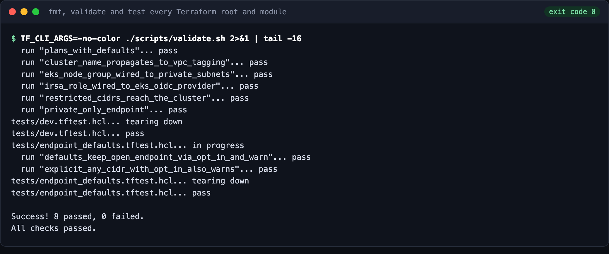
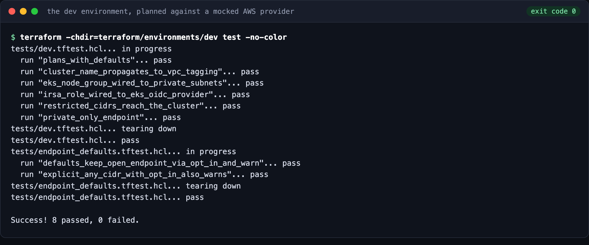
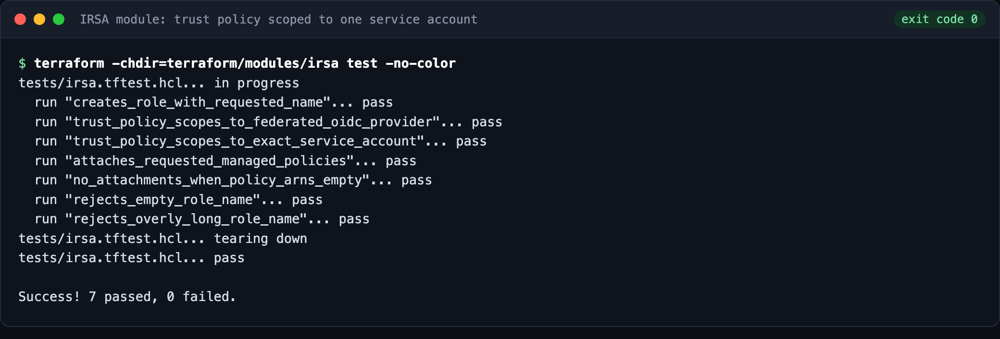
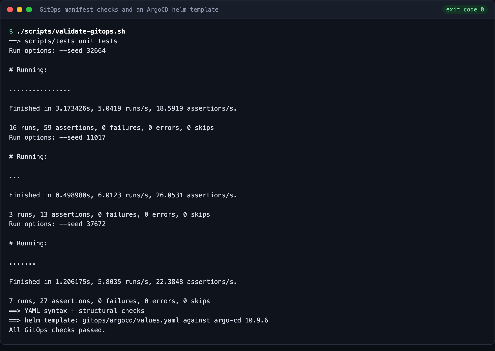
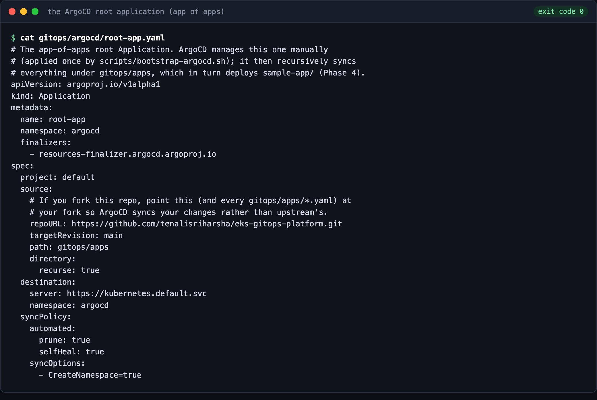
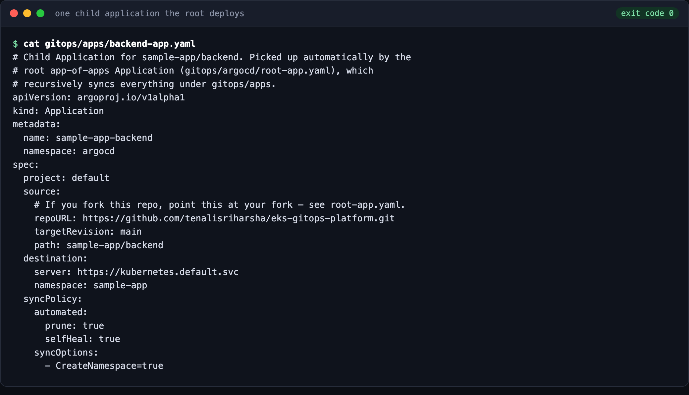
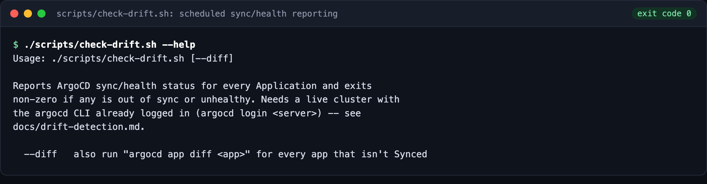

# eks-gitops-platform

[](https://github.com/tenalisriharsha/eks-gitops-platform/actions/workflows/validate.yml) [](LICENSE)

Provisions a real AWS EKS cluster via Terraform — VPC, managed node groups,
and IRSA — then layers ArgoCD on top in an app-of-apps pattern to
GitOps-deploy a sample multi-service application. Every Application syncs
with `selfHeal` on, a `check-drift.sh` script reports sync/health status for
scheduled drift visibility, and a documented rollback runbook covers both
the normal `git revert` path and a manual `kubectl` fallback.

## Preview

Every image is generated by [`scripts/capture_screenshots.py`](scripts/capture_screenshots.py), which runs the exact
command shown from the repository root and captures its real output and exit code (a plain-text transcript sits next to
each image in `docs/screenshots/`). No AWS account is involved: the Terraform tests run against a mocked provider, and
the GitOps manifests are checked offline.

**All Terraform roots and modules** are formatted, validated and tested:



**The dev environment** is planned end to end against a mocked AWS provider: VPC, EKS node group on private subnets,
IRSA wired to the cluster's OIDC provider, and a private-only API endpoint:



**IRSA.** The role's trust policy is scoped to exactly one Kubernetes service account:



**GitOps checks.** Unit tests for the manifest checker, YAML structure checks, and a `helm template` of the ArgoCD
values against the pinned chart:



**App of apps.** One root Application that ArgoCD applies once, which then syncs every child application under
`gitops/apps`, with automated prune and self-heal:




**Drift detection.** `scripts/check-drift.sh` reports every Application's sync/health status and exits non-zero on
drift, meant to run on a schedule against a real cluster (`selfHeal` already corrects most drift automatically — see
[docs/drift-detection.md](docs/drift-detection.md)):



## Repository layout

```
terraform/
  modules/vpc/          VPC module: subnets, NAT/IGW, route tables, EKS tags
  modules/eks/           EKS module: control plane, managed node group, OIDC provider
  modules/irsa/          IRSA module: per-service-account IAM role + trust policy
  environments/dev/     Root module wiring vpc -> eks -> irsa for dev
gitops/
  argocd/                Helm values + app-of-apps root Application
  apps/                  Child Applications, one per sample-app service
sample-app/             frontend/backend/cache manifests deployed by gitops/apps
docs/                   Architecture notes and runbooks
scripts/                Local validation / bootstrap / drift-check scripts
```

## Working locally

Two independent layers, two validation scripts — neither needs real AWS
credentials or a live cluster (both need network access on first run to
download Terraform providers / the argo-cd chart):

```sh
./scripts/validate.sh         # terraform fmt/validate/test, mocked aws/tls providers
./scripts/validate-gitops.sh  # YAML + required-field checks, helm template render
make validate-all              # both
```

`validate.sh` runs `terraform fmt -check`, `terraform validate`, and
`terraform test` for every Terraform module and the dev environment, against
**mocked** `aws`/`tls` providers. `terraform init` still downloads the real
providers from registry.terraform.io, so this needs network access.

`validate-gitops.sh` runs the Ruby unit tests in `scripts/tests/`, then
checks YAML syntax and required fields on everything under `gitops/` and
`sample-app/` (pure Ruby stdlib, no network), then `helm template`-renders
`gitops/argocd/values.yaml` against the pinned argo-cd chart (needs network
to fetch the chart, but no cluster).

## Cluster API access

The EKS module refuses to create a public API endpoint open to `0.0.0.0/0`
unless you opt in with `allow_open_public_endpoint = true`. Pass
`endpoint_public_access_cidrs` (e.g. your egress IP as `/32`) or disable the
public endpoint and reach it privately. The dev environment keeps the
historical open endpoint as an explicit, commented opt-in and warns on every
plan; copy `terraform/environments/dev/terraform.tfvars.example` to lock it
down. Details and tradeoffs: [docs/cluster-access.md](docs/cluster-access.md).

## Deploying

Actually installing ArgoCD needs a real EKS cluster — provision one with the
Terraform in `terraform/environments/dev`, point kubectl at it
(`aws eks update-kubeconfig --name <cluster_name>`), then run
`./scripts/bootstrap-argocd.sh`. See [gitops/README.md](gitops/README.md). It
installs the app-of-apps root `Application`, which recursively syncs the
three child Applications in `gitops/apps/` — see
[sample-app/README.md](sample-app/README.md) for what gets deployed and what
"synced" should look like.

## Drift detection and rollback

Every Application has `selfHeal: true`, so most drift (a manual `kubectl edit`, a stray deletion) is corrected
automatically within seconds. `./scripts/check-drift.sh` adds the visibility piece selfHeal doesn't: a scheduled
report of every Application's sync/health status, meant for cron or a scheduled CI job against a real cluster. See
[docs/drift-detection.md](docs/drift-detection.md). If a bad change needs undoing, [docs/rollback-runbook.md](docs/rollback-runbook.md)
walks through the `git revert` + `argocd app sync` path (with a worked example) and a manual `kubectl` fallback.

## Status

All five planned phases are done: the Terraform foundation, the EKS cluster with IRSA, the ArgoCD bootstrap, a
multi-service sample app deployed through GitOps, a hardening pass on the EKS API endpoint, and drift
detection/rollback tooling and docs. Everything is validated offline (`terraform validate`, `terraform test`, manifest
checks, `check-drift.sh` unit tests against a stub `argocd` CLI); the Terraform has never been applied to a real AWS
account, and the ArgoCD/drift tooling has never run against a live cluster. See [PROGRESS.md](PROGRESS.md) for the
full build history and [DAILY_REPORT.md](DAILY_REPORT.md) for a summary.

## License

MIT — see [LICENSE](LICENSE).
